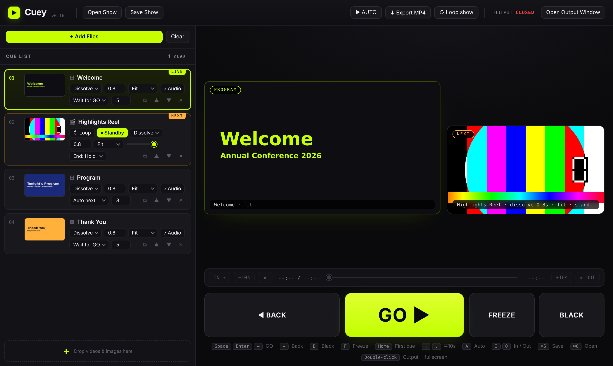

<p align="center">
  
</p>
<h1 align="center">Cuey</h1>
<p align="center"><b>Video &amp; slides for live events. One button. GO.</b><br>
Free · Mac &amp; Windows · No PowerPoint, no VJ software, no crew.</p>
<p align="center">
  <a href="https://bergerman1-svg.github.io/cuey/app/">▶ Open in browser</a> ·
  <a href="https://bergerman1-svg.github.io/cuey/">Website & direct download</a>
</p>



## Why

Every school ceremony, lecture, conference and family event has a screen — and someone who has to make videos and slides appear on it, in order, on time.
Today that means PowerPoint with embedded media that breaks, or professional playback software (vMix, Resolume, QLab) that needs an operator.

Cuey is the thing in between: **drag your files in, plug in the projector, press Space.**

## What it does

- **Cue list** — videos (MP4/MOV/WEBM) and images (JPG/PNG), reorder by drag
- **GO** — Space / Enter / big button advances to the next cue
- **PROGRAM & NEXT** monitors — see exactly what the projector shows (with dissolves), and what's coming
- **Output window** — fullscreen on the second display, automatically
- Per cue: **Cut / Dissolve** (seconds), **Loop**, **Fit / Fill / Stretch**, **volume**
- **Standby** — video comes up on its first frame; the next GO plays it
- **IN / OUT** trim points by dragging markers — no video editor needed
- **Slides with sound** — attach an audio file to a still image
- **Hold time / Auto next** per slide, **AUTO** mode runs the whole list in a loop
- **Export MP4** — render the loop to a single video file
- **BLACK / FREEZE**, 5-second end countdown, timeline with scrub and ±10 s
- **Save / Open** shows (`.cuey`)

## Run from source

```bash
npm install
npm start
```

## Build installers

```bash
npm run dist:mac   # release/Cuey-x.y.z-arm64.dmg, -x64.dmg
npm run dist:win   # release/Cuey-Setup-x.y.z.exe
```

Bump `version` in `package.json` and push to `main` — GitHub Actions builds both installers and publishes a Release automatically.

## Project layout

```
app/cuey.html   the whole application (single file, also runs in Chrome)
main.js         Electron shell: windows, menu, second-display output
preload.js      tiny bridge for native menu commands
docs/           website (GitHub Pages)
build/          icon
```

## License

MIT — © Avi Berger Productions

## Architecture

See [ARCHITECTURE.md](ARCHITECTURE.md) — repo map, data model, stage engine, release procedure, mobile prototype and roadmap.
